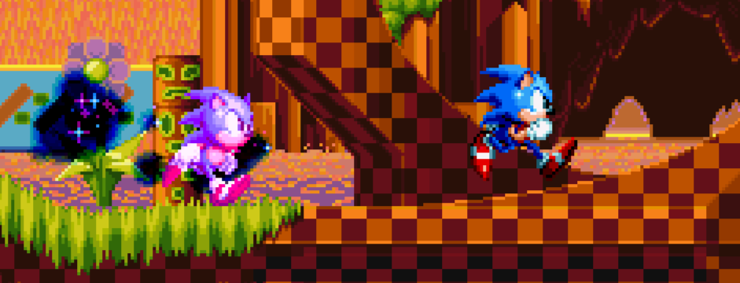

# Phantom Clone Challenge

<p align="center"></p>

A mod that adds Phantom Clones, inspired by *Super Mario Galaxy 2*'s Cosmic Clones.

The clone will spawn roughly as soon as the stage timer starts, and will track your every move. Try not to stay in the same place for long, as the clone will start progressively draining your ring count. Once your ring count hits zero (and you don't have a shield active), it's Game Over!

Don't worry for too long though, any clone will despawn during a boss and will produce three extra rings for you to collect.

## Mod Settings
Upon starting the mod, the engine will automatically generate a `modSettings.ini` file for you to change things to your liking.

`cloneCount` - Determines how many clones will be active. Defaults to one. Entering any number before one or after three will return as one clone.

# Building
In order to build, recursively clone the repo using [Git](https://git-scm.com/install/) with the repo's url: `git clone https://github.com/JamesithM2/Phantom-Clone-Challenge --recursive`

If you've already cloned the repo, use the following commands to update:

```
git pull
git submodule update --remote --init --recursive
```

## CMake
Assure that [GameAPI](https://github.com/RSDKModding/RSDKv5-GameAPI) has been cloned correctly, then type the following commands in the root of the repository:
```
cmake -B build
cmake --build build --config release
```

The resulting build will be located somewhere in `build/` depending on your system.

The following cmake arguments are available when compiling:
- Use these by adding `-D[flag-name]=[value]` to the end of the `cmake -B build` command. For example, to build with `RETRO_DISABLE_PLUS` set to on, add `-DRETRO_DISABLE_PLUS=on` to the command.

### Mod Flags
- `RETRO_REVISION`: What revision to compile for. Takes an integer, defaults to `2` (RSDKv5).
- `RETRO_MOD_LOADER_VER`: Manually sets the mod loader version. Takes an integer, defaults to the latest mod loader version (ModAPIv2).
- `RETRO_INCLUDE_EDITOR`: Whether the mod should include functions and other necessities for RSDKv5 scene editors, such as RetroED (this is not important for this mod). Takes a boolean, defaults to `on`.
- `MANIA_PREPLUS`: Whether or not to build a pre-plus version of Sonic Mania. Takes a boolean, defaults to `off`.
- `MANIA_FIRST_RELEASE`: Whether or not to build for the first console release of Mania. Takes a boolean, defaults to `off`.
- `GAME_VERSION`: Which release version of Sonic Mania to target for. Takes an integer, defaults to `3` when `MANIA_PRE_PLUS` is enabled, and `6` otherwise (last Steam release).

## Visual Studio
Open the Visual Studio solution (`.sln`) in the root directory and build. Double check to make sure certain things like engine revision and mod loader version are consistent with the ones for your decomp install.

## Android
[Ensure the decomp has been set up for building on Android](https://github.com/RSDKModding/RSDKv5-Decompilation/blob/master/dependencies/android/README.md). Follow the instructions to set up symlinks, then add the mod as a symbolic link (make sure the path leads to the root directory).